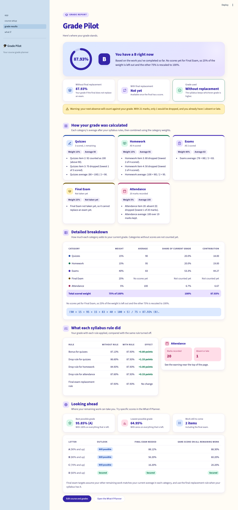
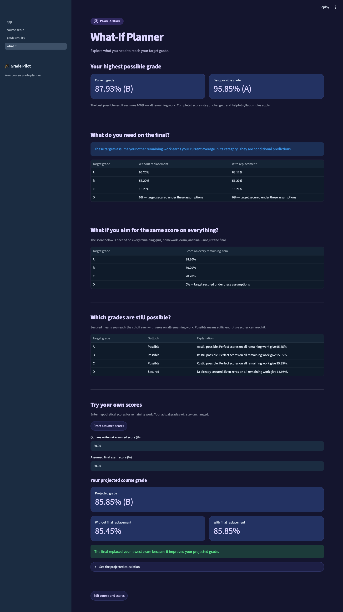

# Grade Pilot screenshots

Taken from the running app with the hackathon sample course (current grade 87.93%, B). Each screen is shown in light and dark mode.

| # | Screen | Light | Dark |
|---|---|---|---|
| 1 | Home page | [01-home-light.png](01-home-light.png) | [01-home-dark.png](01-home-dark.png) |
| 2 | Course setup as a student first sees it: blank scores, ready for their own grades | [02-course-setup-blank-light.png](02-course-setup-blank-light.png) | [02-course-setup-blank-dark.png](02-course-setup-blank-dark.png) |
| 3 | Course setup after "Load sample scores" | [03-course-setup-sample-light.png](03-course-setup-sample-light.png) | [03-course-setup-sample-dark.png](03-course-setup-sample-dark.png) |
| 4 | Grade results: current grade, explanations of every rule, breakdown, and targets | [04-grade-results-light.png](04-grade-results-light.png) | [04-grade-results-dark.png](04-grade-results-dark.png) |
| 5 | What-If Planner: targets, letter outlook, and assumed scores | [05-what-if-planner-light.png](05-what-if-planner-light.png) | [05-what-if-planner-dark.png](05-what-if-planner-dark.png) |

## Grade results

## What-If Planner

